## Pokémon TCG Legacy

## The Game

Pokémon TCG Legacy is my modern take on the old Pokémon Trading Card GB games created from the ground up in Godot GDScript, so this isn't a rom hack or an RPG maker game release, everything in the game has been coded entirely from scratch in the Godot Engine. 

Pokémon TCG 2: The Invasion of Team GR! was released in 2001 and was the last single player PTCG experience we got (And it was never officially released in English!).  For over **25 years** every game since has been an online PvP focused experience. Pokémon TCG Legacy focuses entirely on a single-player experience, building your own collection of cards through in game battles against unique and varied decks and unlocking new sets naturally as you progress (of course with no real world money to spend).

The story isn't a continuation from the original Pokémon TCG GB and GB2, but instead aims to be an entirely unique experience of its own. The story aims to be existing lore-friendly, so you'll be able to meet and play against NPCs from other games and regions as they visit the island.

My aim is to capture the satisfaction of earning and collecting new cards and rewarding experimentation with deck building, facing off against opponents with wildly different decks and strategies. No reliance on established metas meaning you won't be seeing the same deck every match, leaving you free to experiment with the cards you actually want to use.

### Rich open world

Unique locations across the map to explore, each filled with dozens of NPCs and opponents to play against. As you progress you will unlock more areas, NPCs, sets and opponents. Play a match wherever; You can play your match right on the beach!

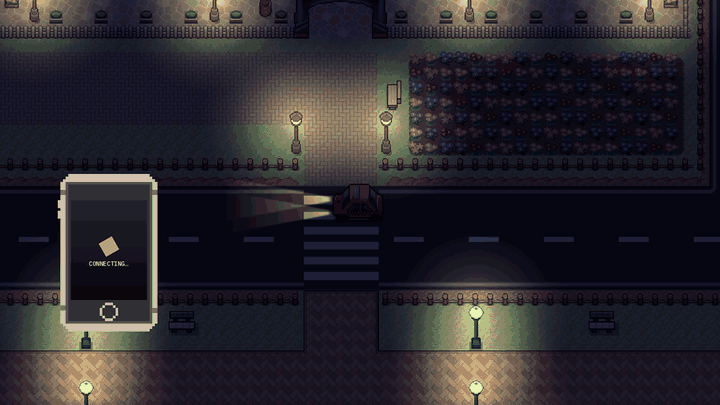

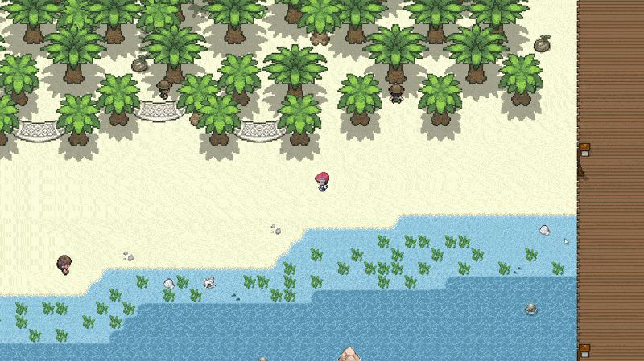

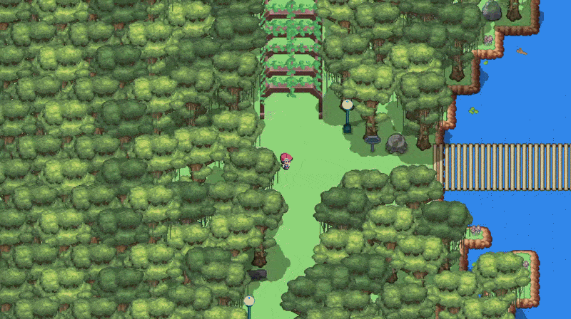

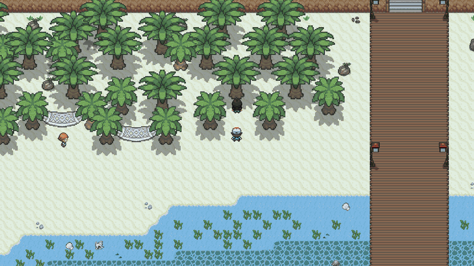

### Battle Simulation Built From Scratch

A battle engine built from the ground up with every card, attack and effect from the first 3 generations. A lot of decks will be genuinely challenging and make your victories earned. Every win rewards you with new cosmetics and cash for more cards.

Choice of playing a full tutorial to learn the game mechanics or get straight in for those who've played before.

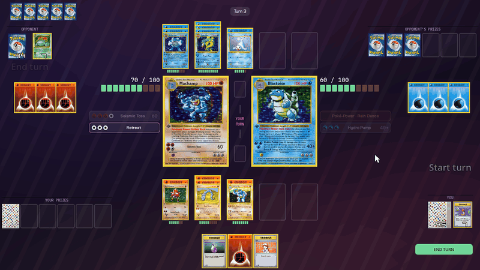

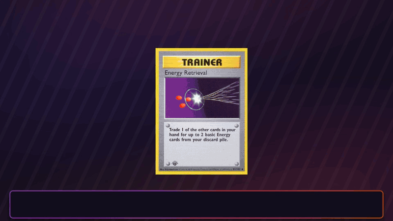

### Day - Night cycles change the landscape

Time progresses throughout the day as you battle. NPCs have different habits, offering gifts, battles or different speech depending on the time of day. The map changes as time progresses, making the world feel actually lived in.

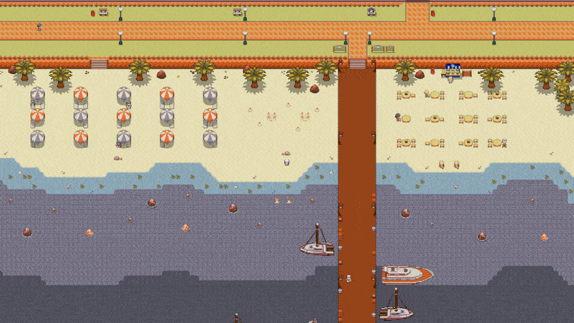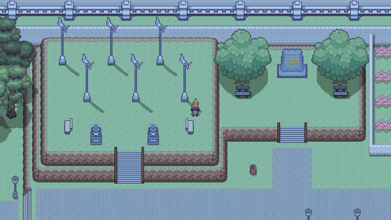

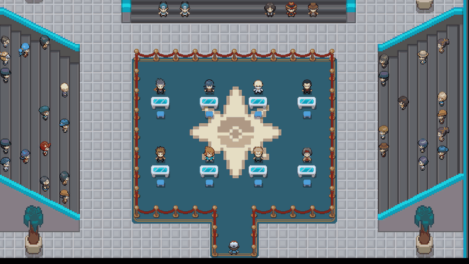

### Complete Card Collection (Base Set → EX Era)

Collect every card from **Base Set** through to **EX Power Keepers**. 3,200+ collectible cards across 37 sets. Build custom decks and experiment freely within the rules of the official Pokémon TCG. All card information is displayed in full detail.

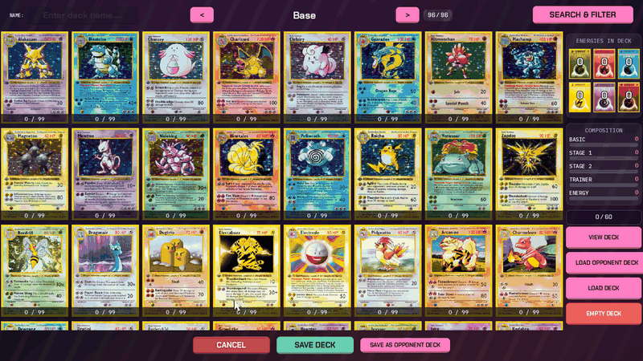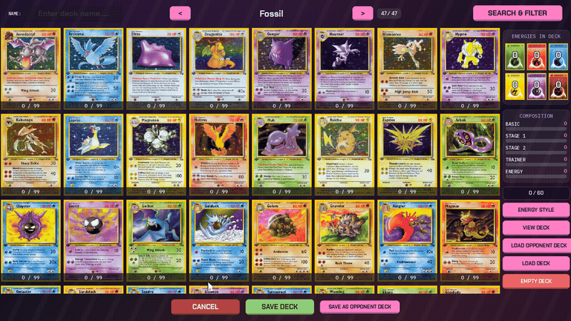

### Familiar NPCs and gifts

Gym leaders from Kanto make an appearance in the overworld, letting you speak to old friends. Some NPCs give you a gift when spoken to, so you build up your collection not just by battling but by talking to everyone.

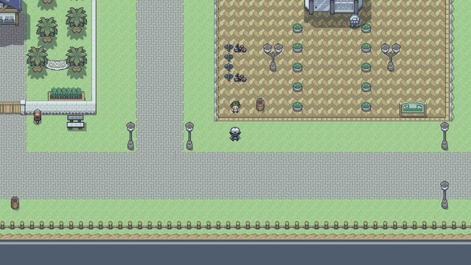

### Pack purchasing

Spend your cash in the Card Marts to buy packs and unlock new cards for your decks. You might get lucky and find a bonus rare card in some packs or possibly....even an elusive god pack?

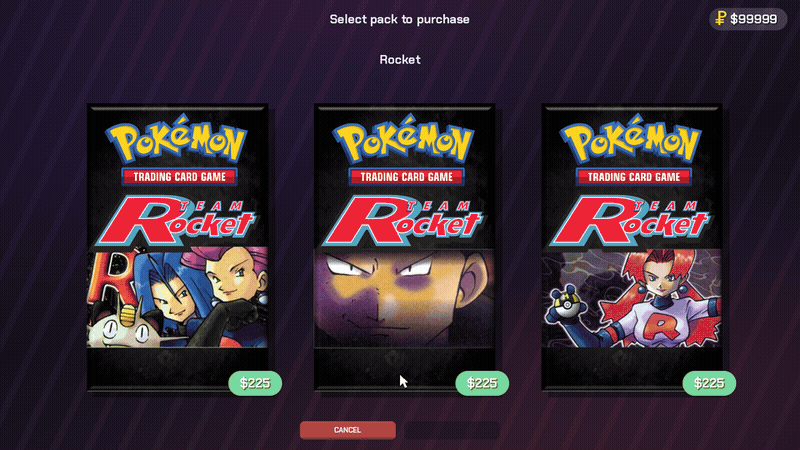 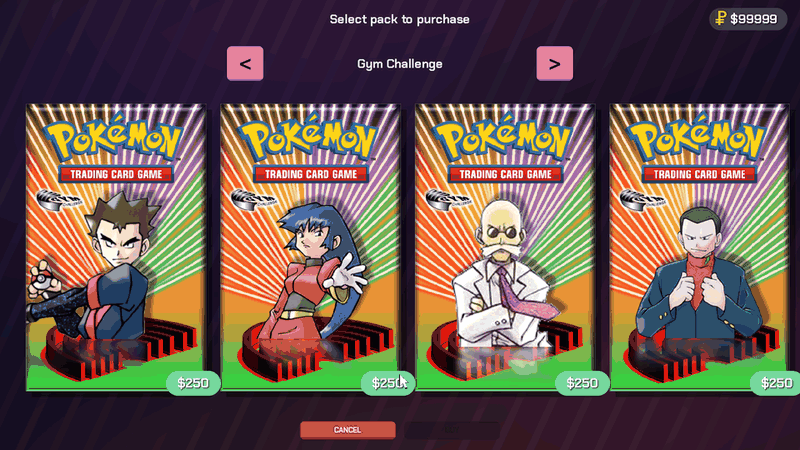

### Trainer Customization

Unlock **200+ unique sprites** as you progress through the game. Set your favourite and see all your in game stats on your trainer card.

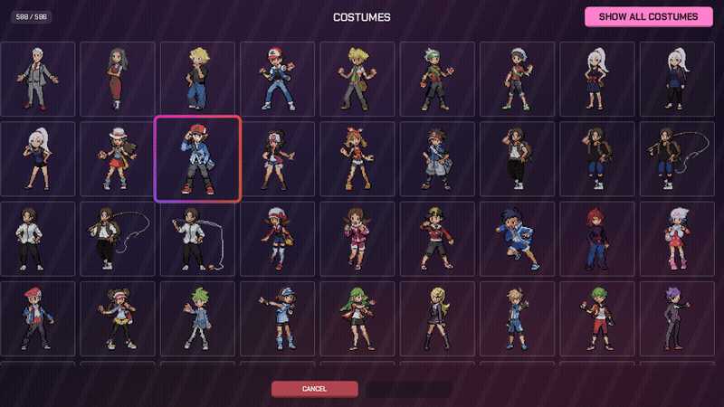

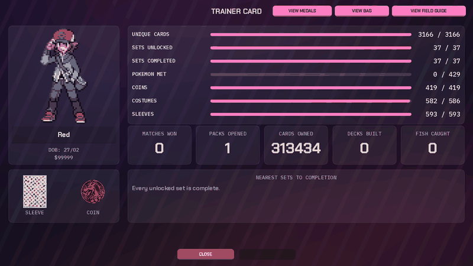

### 400+ Collectible Coins and Card Sleeves

Win coins and sleeves as rewards for every battle and find some as gifts to use in your matches.

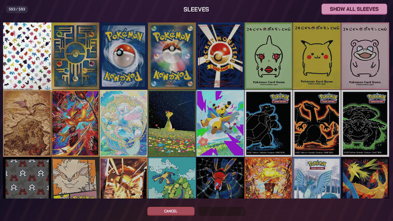

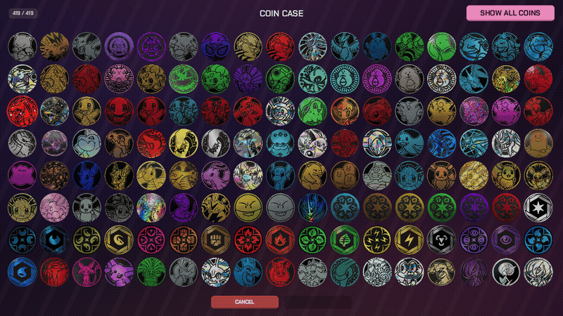

### Endless replayability

Hundreds of unique decks and opponents so you never have to battle the same opponent twice! (Unless you want to). If you need to take a break from playing cards you can try your hand at Fishing at different spots around the island and while you can't catch Pokémon (you're not a trainer!) you can still make friends with some wild Pokémon and even have them evolve! Who knew Pokémon loved cards?

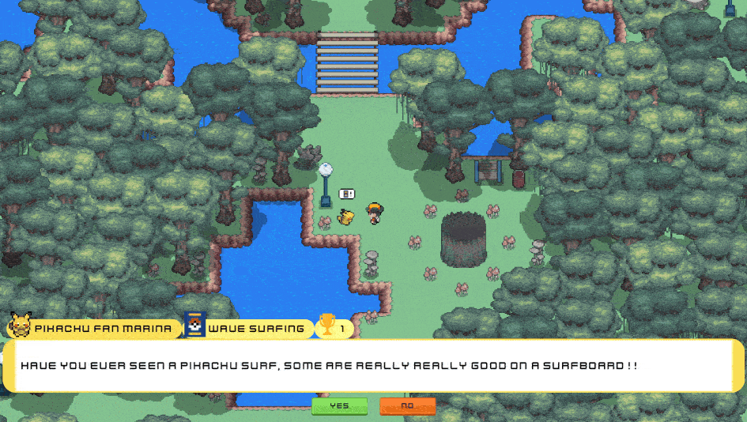

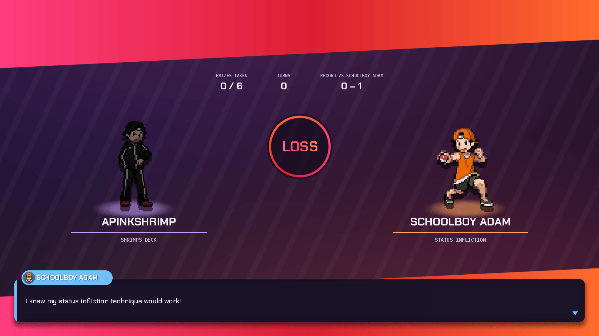

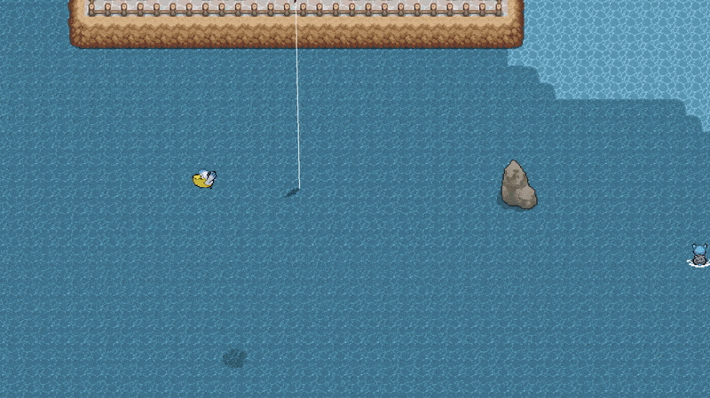

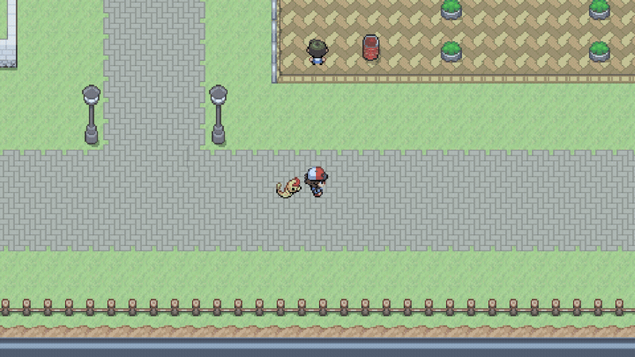

## Technical

Built in **Godot 4.6** using GDScript.

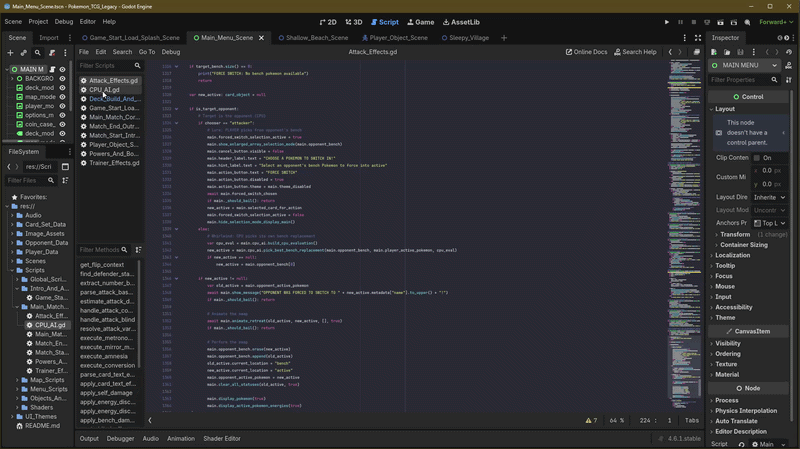

# Update on 18/11/2026

Every single card set is now technically implemented. That's all 37 sets and over 3,200 cards playable covering Promos, e-card series, neo, the entire EX era and POP series 1-5.

Key things **already implemented** to look forward to:

1. All cards from Base Set to Gym Heroes/Challenge can be used, earned and purchased from in shops, technically every card from neo-ex power keepers is implemented but not obtainable.
2. Full TCG battle engine written from scratch, all 1061 unique attack effects, 270 Poke-powers and bodies, 284 trainers, 52 stadium cards and 19 special energies all implemented faithfully to the original prints.
3. A CPU opponent with board evaluation, providing a genuine challenge to battle against.
4. All main explorable areas completed for the Kanto era cards with both open exteriors and explorable interiors mapped.
5. Living Morning, Afternoon, Evening and Night cycle with different NPC behaviours and map changes depending on the time of day.
6. 100+ Opponents to battle already with another 100 NPCs to interact with, all with unique dialogue, gifts and changing interactions depending on time of day. 
7. "Boss" battles with meta decks and Gym Leader gauntlet resulting in story progression and big rewards
8. Challenge battles with a combination of 31 different gameplay modifiers such as damage multipliers, weakness and resistance changes, double energy attachment and card restrictions.
9. Complete deck builder and card database, allowing you to build decks with any of the 3,200+ cards and view them full screen with card text in full detail. Advanced filtering to search for specific cards.
10. Hundreds of cosmetics to chase: 221 trainer sprites, 589 card sleeves, 419 collectible coins, five trainer card designs and six energy card styles, all tracked on your trainer card.
11. Following Pokémon! Make friends with wild Pokémon around the island, give them a home and a bed and they'll follow you around. Some of them can even evolve.

The game is technically playable now, you could download the godot project from git and run it in debug mode and get a couple hours enjoyment out of it, but it's still buggy and janky with a lot of issues that need working out. I'm still adding a few final features, a bit of polish and most importantly debugging the hundreds of issues that exist. I'm aiming to have the game fully playable by the end of the year.

## Planned features and gameplay progression plan before considering done

1. Most immediate requirements are now just fixing all the bugs within the battle system and main game.

2. More NPCs need adding to flesh out the world and add flavour text, guidance or gifts.

3. All decks need battling against fully and adjusting to make them as good as possible. A lot of decks will require tweaking.

4. Add more Pokémon to the overworld to flesh out the world along with the additional NPCs.

5. The three leads (Ellie, Olly and Alexander) take the rival/friend role, with specific interactions helping you start the game, giving you a nudge in the right direction and testing your skill as you progress. Days 1-3 are built; day 4 onwards is still to write.

Consider this phase 1 complete and a 'finished' game that's playable with a story and rich enough features to be a dozen or so hours gameplay

# Phase 2 definitely coming next

1. Add Neo set era cards available to use and purchase
2. Create another 100+ decks from Neo era with 100+ Opponents to match
3. Add "Southern Island" map area with complete SI set gifted for beating all opponents, while also recreating Southern island cards to fix terrible reverse holo image scans
4. 3-4 new major map areas for Neo era cards. Travel between all areas via train and boat
5. Recreate custom translated versions of the Pokémon VS set and implement into the game resulting in Johto Gym Challenge using the VS set

Consider this end of phase 2 and next large update to game

# Future features planned

1. Unlock all EX generation card sets from Ruby Sapphire to end of Delta species
2. Implement EX era overworlds and opponents
3. Add double battle matches as per EX era rulesets

Consider this finished game as intended and planned

# Unplanned features

1. Diamond/Pearl onwards currently not planned to be implemented
2. Release will be windows exe only, definitely no iOS but maybe an android APK at best if it's easy enough to export for free...

---

**Status**: Active Development and technically playable. Roughly 80% complete before phase 1 release
